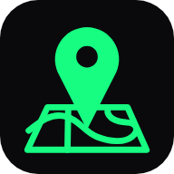

<div align="center">
  

# Beenzer

**Been there. Done that.**

The website of Beenzer, the geo-social app by [Nexow, Inc.](https://nexow.studio): photos and videos pinned to the place they were taken, with optional Solana NFTs.

[beenzer.app](https://beenzer.app) · [Beenzer at Nexow](https://nexow.studio/products/beenzer) · [@beenzer_app](https://x.com/beenzer_app)

</div>

---

## What is on the site

| Page                | What it does                                                                                                                                                       |
| ------------------- | ------------------------------------------------------------------------------------------------------------------------------------------------------------------ |
| `/`                 | The scroll dive: a dot-matrix Earth the camera falls onto, down to the shore of Lake Geneva where BEENZER #18 was minted. Then how the app works, on-chain, story, crew, journal, FAQ. |
| `/journal/`         | News and guides, written in Markdown in `src/content/journal/`.                                                                                                    |
| `/legal/`           | Site notice: who runs the site, and what it does with data (nothing: no cookies, analytics or trackers).                                                          |
| `/dao/`             | Where the old DAO page sends people now.                                                                                                                           |
| `/404`              | Nothing pinned here.                                                                                                                                               |

### The hero

`src/scripts/globe.ts` is one idea, stated at the top of the file: scrolling drops the camera from orbit onto the exact spot one real Beenzer was posted, and the map resolves as it comes down. The land is about 85,000 dots in five levels of detail, each about 2.6 times finer than the last, so the density on screen stays even from orbit to the ground. The 3D pin at the end is the logo's, extruded.

- Three.js loads after the headline has painted, when the browser is idle.
- The render loop stops when the hero is off-screen or the tab is hidden; the pixel ratio is capped at 2.
- With `prefers-reduced-motion`, there is one still frame and normal scrolling. Without WebGL, a rendered poster of the same globe takes its place.

### Facts only

Everything the site states comes from a source, noted next to it in `src/data/`: the app's code and plan in `nexow-ai/beenzer`, Nexow's own site, and Solana mainnet. BEENZER #18 was read from the chain and its Arweave metadata; its coordinates are rounded to about a kilometre, the post's own visibility radius. Nothing invents a number, a user, a quote or a date.

## Develop

Requires Node 22 (`.nvmrc`).

```bash
npm ci            # install from the lockfile (versions are pinned exactly)
npm run dev       # http://localhost:4321
npm run check     # types and Astro diagnostics
npm run build     # static site in dist/
npm run preview   # serve dist/
```

### Globe data

`public/globe/land.bin` (20 KB, 6 KB gzipped) is a land mask: one bit per point of the lattices in `src/lib/lattice.js`, which the page turns back into positions. It is committed. To rebuild it after changing the lattices or the target:

```bash
npm run globe     # Natural Earth land via world-atlas, lakes from scripts/data/lakes-alps.json
```

### Media

`public/media/` holds the phone clips and the original app walkthrough, re-encoded for the web (H.264, `+faststart`, no audio except the walkthrough). Photos live in `src/assets/` and are resized and converted to WebP at build time.

## Deploy

The build is a static folder. Two ways:

- **Cloudflare Workers**, like nexow.studio: `npm run deploy` (uses `wrangler.jsonc`; attach the domain in the dashboard first).
- **Any static host**: publish `dist/`. `public/_redirects` sends the original site's addresses (`/dao.html`, `/doc.html`, `/html/*`) to their new homes on hosts that read it (Cloudflare, Netlify).

## Structure

```
src/
  pages/        index, journal, legal, dao, 404
  components/   Hero, AppTour, Showcase, OnChain, Story, Team, Faq, Follow, Header, Footer, Logo, Icon
  scripts/      globe.ts (WebGL), motion.ts (Lenis + GSAP: one clock for the page)
  content/      journal posts (Markdown)
  data/         site facts, team, FAQ, globe pins
  lib/          lattice.js (shared with scripts/), icons
  styles/       global.css (tokens, type, controls)
public/         icons, OG image, globe mask and poster, media, redirects
scripts/        build-globe.mjs
```

## Contributing

See [CONTRIBUTING.md](CONTRIBUTING.md). Work on `dev`; `main` is what ships.

## License

Copyright © 2022–2026 Nexow, Inc. The code is under the [MIT License](LICENSE). The Beenzer name and logo, the photos, videos and other media in this repository are not covered by it and may not be reused without permission.
